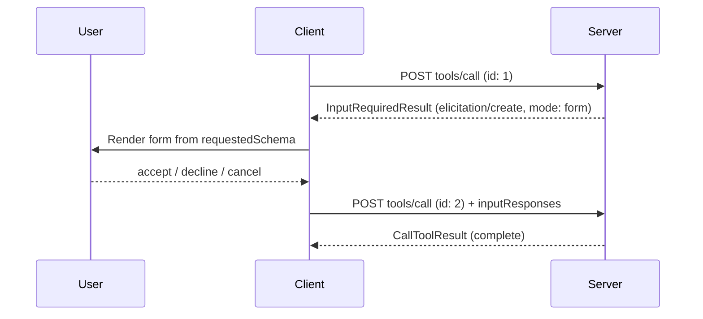

A form-eliciting tool is a normal `tools/call`. The first POST returns `resultType: "input_required"` with an `elicitation/create` form inside `inputRequests`. The client shows that form, then POSTs the **same** `tools/call` again with the answers in `inputResponses`. That retry is a new HTTP request. Everything the tool needs is in that body.

<Info>
Protocol revision `2026-07-28`. Transport: Streamable HTTP with `WithHttpTransport(o => o.Stateless = true)`. Pattern: Multi Round-Trip Requests (SEP-2322).
</Info>



<Columns cols={3}>
  <Card title="POST 1 asks" icon="circle-1">
    The tool throws `InputRequiredException`. The SDK writes `InputRequiredResult`. That HTTP request is finished.
  </Card>
  <Card title="The client collects" icon="clipboard-list">
    The host renders `message` and `requestedSchema`. The user accepts, declines, or cancels.
  </Card>
  <Card title="POST 2 answers" icon="circle-2">
    Same tool name and arguments, new JSON-RPC `id`, answers under the same key the server used.
  </Card>
</Columns>

## Three names

These three strings travel in different places. Mixing them up is the usual first-try failure.

| Name | Example | Where it lives |
|---|---|---|
| Tool name | `ShipOrder` | `[McpServerTool(Name = ...)]`, `params.name`, `Mcp-Name` |
| Input-request key | `ship` | `AddFormElicitation`, `inputRequests`, `inputResponses` |
| Field name | `trackingNumber` | schema `properties`, `ElicitResult.Content` |

<Tip>
The dictionary key you pass to `RequireForm` (`"ship"`) is the key on `inputRequests` / `inputResponses`. Field names live only inside `content`.
</Tip>

## Build the server

Packages: `ModelContextProtocol.AspNetCore` 2.x and `CloudNimble.McpEssentials.Core`.

<Steps titleSize="h3">
  <Step title="Register the form" icon="bookmark">
    `AddFormElicitation("ship", …)` stores a keyed singleton `IFormElicitationSource`. `ToInputRequest()` seals the builder and wraps `Build()` as `InputRequest.ForElicitation`: `method` is `elicitation/create`, `params.mode` is `"form"`, plus `message` and a flat `requestedSchema`.

    ```csharp
    using CloudNimble.McpEssentials.Core.Tasks.Elicitations;
    using Microsoft.AspNetCore.Builder;
    using Microsoft.Extensions.DependencyInjection;

    var builder = WebApplication.CreateBuilder(args);

    builder.Services.AddFormElicitation("ship",
        FormElicitationBuilder.Create("Ship this order")
            .String("trackingNumber").Required());
    ```
  </Step>

  <Step title="Host Streamable HTTP" icon="server">
    `MapMcp()` with no path maps POST to `/`.

    ```csharp
    builder.Services.AddHttpContextAccessor();
    builder.Services.AddMcpServer()
        .WithHttpTransport(options => options.Stateless = true)
        .WithTools<ShippingTools>()
        .WithTasksPlus(sp => sp.GetRequiredService<IHttpContextAccessor>().HttpContext?.User);

    var app = builder.Build();
    app.MapMcp();
    app.Run();
    ```
  </Step>

  <Step title="Write the tool" icon="wrench">
    Return an immediate result (`string`). Stamp the method with `[McpElicitForm("ship")]`. Call `context.RequireForm("ship")`.

    First visit throws `InputRequiredException`. The SDK writes that as `resultType: "input_required"`. That POST is finished. The retry returns the `ElicitResult`.

    `IsAccepted` is `Action == "accept"` (ordinal ignore-case). The other actions are `"decline"` and `"cancel"`. Unset `Action` defaults to `"cancel"`. If a required answer is still missing, `RequireForm` throws again. The client retries.

    ```csharp
    using System.ComponentModel;
    using CloudNimble.McpEssentials.Core.Tasks.Elicitations;
    using ModelContextProtocol.Protocol;
    using ModelContextProtocol.Server;

    [McpServerToolType]
    public class ShippingTools
    {
        [McpServerTool(Name = "ShipOrder"), Description("Asks for a tracking number, then ships.")]
        [McpElicitForm("ship")]
        public static string ShipOrder(RequestContext<CallToolRequestParams> context)
        {
            var result = context.RequireForm("ship");
            if (!result.IsAccepted)
            {
                return "Shipping cancelled.";
            }

            return $"Shipped as {result.Content!["trackingNumber"].GetString()}.";
        }
    }
    ```
  </Step>
</Steps>

<AccordionGroup>
  <Accordion title="What ToInputRequest() puts on the wire" icon="code">
    For the `"ship"` form above:

    - `method`: `elicitation/create` (`RequestMethods.ElicitationCreate`)
    - `params.mode`: `"form"`
    - `params.message`: `"Ship this order"`
    - `params.requestedSchema`: a JSON Schema object whose `properties.trackingNumber` is `{ "type": "string", "title": "Tracking Number" }` and whose `required` list contains `"trackingNumber"`
  </Accordion>

  <Accordion title="Schema profile" icon="shapes">
    Form mode is a **flat object of primitives**:

    | Kind | JSON Schema |
    |---|---|
    | String | `type: string`; formats `email`, `uri`, `date`, `date-time` |
    | Integer / number | `type: integer` or `type: number`, with `minimum` / `maximum` |
    | Boolean | `type: boolean` |
    | Single-select | `enum`, or titled `oneOf` with `const` + `title` |
    | Multi-select | `type: array` of those enum shapes |

    Nested objects, arrays of objects, and other JSON Schema features are out of profile.
  </Accordion>

  <Accordion title="If the host already registers Tasks" icon="list-check">
    `[McpElicitForm("ship")]` is enough. `WithTasksPlus` selects `McpTaskExecutionMode.Synchronous` for that tool. `[McpElicitUrl]` is `Optional` so a task can outlive the POST. Other tools stay `Optional`.
  </Accordion>
</AccordionGroup>

## Call the tool

Every request carries protocol metadata in the body. Streamable HTTP also mirrors selected fields into headers; those headers must match the body.

<Tabs>
  <Tab title="POST 1 — ask" icon="paper-plane">
    ```http
    POST / HTTP/1.1
    Host: localhost:5280
    Content-Type: application/json
    Accept: application/json, text/event-stream
    MCP-Protocol-Version: 2026-07-28
    Mcp-Method: tools/call
    Mcp-Name: ShipOrder

    {
      "jsonrpc": "2.0",
      "id": 1,
      "method": "tools/call",
      "params": {
        "name": "ShipOrder",
        "arguments": {},
        "_meta": {
          "io.modelcontextprotocol/protocolVersion": "2026-07-28",
          "io.modelcontextprotocol/clientCapabilities": {
            "elicitation": { "form": {} }
          }
        }
      }
    }
    ```

    The `elicitation/create` object is nested inside the `tools/call` result. It is part of `InputRequiredResult.inputRequests`.

    ```json
    {
      "jsonrpc": "2.0",
      "id": 1,
      "result": {
        "resultType": "input_required",
        "inputRequests": {
          "ship": {
            "method": "elicitation/create",
            "params": {
              "mode": "form",
              "message": "Ship this order",
              "requestedSchema": {
                "type": "object",
                "properties": {
                  "trackingNumber": {
                    "type": "string",
                    "title": "Tracking Number"
                  }
                },
                "required": ["trackingNumber"]
              }
            }
          }
        }
      }
    }
    ```

    This example omits `requestState`. The retry omits it as well. If the server does send `requestState`, the client copies that string onto the retry unchanged.
  </Tab>

  <Tab title="The form answer" icon="pen-field">
    The client renders `message` and `requestedSchema`, then returns an `ElicitResult`. Content keys are the schema property names (`trackingNumber`). The map key that wraps this object on the retry is still `"ship"`.

    ```json
    {
      "action": "accept",
      "content": { "trackingNumber": "1Z999" }
    }
    ```
  </Tab>

  <Tab title="POST 2 — answer" icon="rotate">
    New JSON-RPC `id`. Same `method`, `params.name`, `params.arguments`, `_meta`, and headers. Add `inputResponses` under `"ship"`.

    ```http
    POST / HTTP/1.1
    Host: localhost:5280
    Content-Type: application/json
    Accept: application/json, text/event-stream
    MCP-Protocol-Version: 2026-07-28
    Mcp-Method: tools/call
    Mcp-Name: ShipOrder

    {
      "jsonrpc": "2.0",
      "id": 2,
      "method": "tools/call",
      "params": {
        "name": "ShipOrder",
        "arguments": {},
        "inputResponses": {
          "ship": {
            "action": "accept",
            "content": { "trackingNumber": "1Z999" }
          }
        },
        "_meta": {
          "io.modelcontextprotocol/protocolVersion": "2026-07-28",
          "io.modelcontextprotocol/clientCapabilities": {
            "elicitation": { "form": {} }
          }
        }
      }
    }
    ```

    The tool runs from the top. `InputResponses["ship"]` deserializes to `ElicitResult`. The method returns a string. The SDK wraps that as a `CallToolResult`. Spec `resultType` for that success result is `"complete"`; a missing `resultType` is treated as `"complete"`.

    ```json
    {
      "jsonrpc": "2.0",
      "id": 2,
      "result": {
        "resultType": "complete",
        "content": [
          { "type": "text", "text": "Shipped as 1Z999." }
        ]
      }
    }
    ```
  </Tab>
</Tabs>

<AccordionGroup>
  <Accordion title="Required headers and _meta" icon="heading">
    | Requirement | Failure |
    |---|---|
    | `Accept` lists both `application/json` and `text/event-stream` | The client cannot accept the server's JSON or SSE reply |
    | `MCP-Protocol-Version` equals `_meta.io.modelcontextprotocol/protocolVersion` (`2026-07-28`) | HTTP 400, JSON-RPC `-32020` (`HeaderMismatch`) |
    | `Mcp-Method` equals `method`; `Mcp-Name` equals `params.name` | HTTP 400, JSON-RPC `-32020` (`HeaderMismatch`) |
    | `_meta.io.modelcontextprotocol/protocolVersion` and `_meta.io.modelcontextprotocol/clientCapabilities` are present | HTTP 400, JSON-RPC `-32602` |
    | `clientCapabilities.elicitation` is declared | HTTP 400, JSON-RPC `-32021` (`MissingRequiredClientCapability`) when this tool throws a form `InputRequiredException` |

    `"elicitation": { "form": {} }` and `"elicitation": {}` both advertise form mode.

    `clientInfo` is optional. `Origin` is optional; if it is sent and invalid, the spec requires HTTP 403.
  </Accordion>
</AccordionGroup>

## C# SDK client

`CallToolAsync` retries `input_required` through `McpClientImpl.SendRequestAsync`. The handler is required; without it the client throws `InvalidOperationException("Server sent an elicitation input request, but no ElicitationHandler is registered.")`.

That client injects `_meta` (protocol version and capabilities) on every POST. Raw HTTP clients send it themselves.

```csharp
var client = await McpClient.CreateAsync(
    new HttpClientTransport(new() { Endpoint = new Uri("http://localhost:5280/") }),
    new McpClientOptions
    {
        Capabilities = new ClientCapabilities
        {
            Elicitation = new ElicitationCapability { Form = new FormElicitationCapability() }
        },
        Handlers = new McpClientHandlers
        {
            ElicitationHandler = HandleFormAsync
        }
    });

var call = await client.CallToolAsync("ShipOrder");

static ValueTask<ElicitResult> HandleFormAsync(
    ElicitRequestParams? requestParams,
    CancellationToken cancellationToken)
{
    return new ValueTask<ElicitResult>(new ElicitResult
    {
        Action = "accept",
        Content = new Dictionary<string, JsonElement>
        {
            ["trackingNumber"] = JsonSerializer.SerializeToElement("1Z999")
        }
    });
}
```

## Form-mode rules

<AccordionGroup>
  <Accordion title="What a form may collect" icon="check">
    Fields are a flat object of primitives. Clients that support defaults pre-fill `default`. The server validates returned content against the schema it sent.
  </Accordion>

  <Accordion title="Secrets and credentials" icon="shield">
    Passwords, API keys, access tokens, and payment credentials use URL mode. Form mode is for ordinary structured values the host may see.
  </Accordion>

  <Accordion title="Accept, decline, cancel" icon="hand">
    The client UI names the server that asked, and it offers accept, decline, and cancel. Handle all three on the retry.
  </Accordion>

  <Accordion title="requestState" icon="lock">
    When used, `requestState` is an opaque string. If it affects authorization or business logic, integrity-protect it (HMAC/AEAD), bind it to the user, give it a TTL, and reject a mismatch. Treat it as attacker-controlled on the retry.
  </Accordion>
</AccordionGroup>

## First-try checklist

<Check>
Complete this list before the first `tools/call`.
</Check>

<Steps>
  <Step title="Host">
    `WithHttpTransport(o => o.Stateless = true)`, `WithTools<ShippingTools>()`, `MapMcp()`.
  </Step>
  <Step title="Form and tool">
    `AddFormElicitation("ship", …)` and a `[McpServerTool(Name = "ShipOrder")]` method that returns `string`.
  </Step>
  <Step title="Tasks, if already registered">
    `[McpElicitForm("ship")]` makes `WithTasksPlus` keep `ShipOrder` on `tools/call`.
  </Step>
  <Step title="First visit and retry">
    `RequireForm("ship")` throws on the first visit. The retry returns the `ElicitResult`.
  </Step>
  <Step title="Client">
    `2026-07-28` in the header and in `_meta`, form elicitation advertised, and an `ElicitationHandler` (C# SDK) or an equivalent form UI (raw HTTP).
  </Step>
  <Step title="Headers">
    `MCP-Protocol-Version`, `Mcp-Method`, and `Mcp-Name` match the body.
  </Step>
  <Step title="Retry payload">
    New JSON-RPC `id`, the same tool name and arguments, and `inputResponses.ship`.
  </Step>
</Steps>

## Related

<Columns cols={2}>
  <Card title="Form elicitation" icon="clipboard-list" href="/mcpessentials/guides/form-elicitation">
    `Create`, `From<T>`, field kinds, XML, and analyzers.
  </Card>
  <Card title="Analyzers" icon="wand-magic-sparkles" href="/mcpessentials/guides/analyzers">
    Compiler diagnostics for `From<T>` and expression starters.
  </Card>
</Columns>
